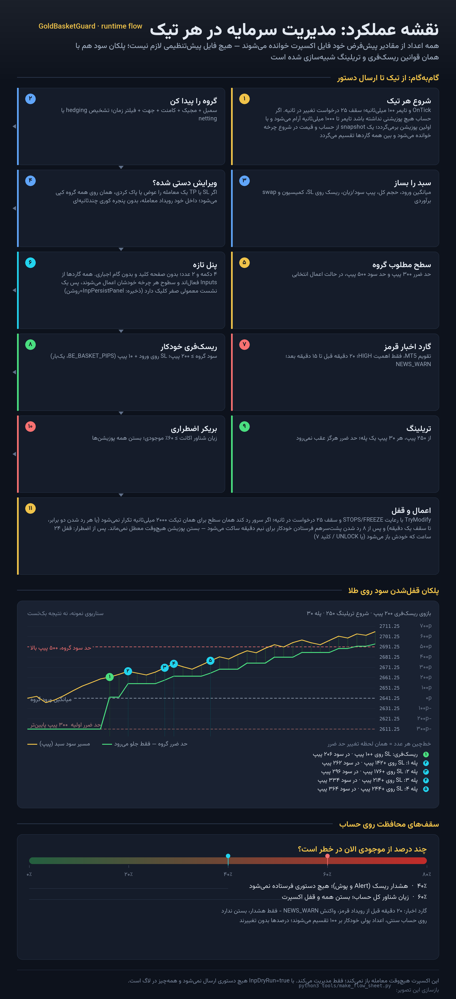

# my-new-trading-system

اکسپرت **GoldBasketGuard** برای متاتریدر ۵ — مدیریت **گروهی** حد سود و حد ضرر + **ریسک‌فری (سربه‌سر) خودکار**، طراحی‌شده برای **طلا (XAUUSD)**.

فایل اصلی: [`MQL5/Experts/GoldBasketGuard/GoldBasketGuard.mq5`](MQL5/Experts/GoldBasketGuard/GoldBasketGuard.mq5)
نسخهٔ نهایی (فایل اکسپرت + مستندات + تصویرها، آمادهٔ دانلود): [`release/GoldBasketGuard/`](release/GoldBasketGuard/)

### تازه‌ها در نسخهٔ ۱.۱۷ — پنل خلوت و «شروع کن و برو»

خلاصه در یک خط: **هیچ دکمه‌ای لازم نیست.** هر قانونی که اکسپرت اجرا می‌کند در `Inputs` گفته شده
است و از همان ثانیهٔ اتصال اجرا می‌شود؛ پنل از یک کارت شلوغ به یک کارت کوچک تبدیل شد که فقط
**گزارش** می‌دهد و در صورت لزوم اجازهٔ اصلاح فوری می‌دهد.

- **صفحهٔ کلیدها (۱۲ سوئیچ) حذف شد.** هر سوئیچ دقیقاً همان `Input` خودش را روشن/خاموش می‌کرد،
  پس عملاً یک لایهٔ تکراری بود: یک جا دیگر برای گم‌شدن، کلیک اشتباهی، و `OFF*` که فقط توضیح
  می‌داد. حالا **هر قابلیت فقط یک کلید دارد و آن هم در `Inputs` است** — همان‌جا که ذخیره
  می‌شود و در `.set` و لاگ می‌آید.
- **پنل از ۱۲ سطر + ۱۴ دکمه + ۸ کادر به ۸ سطر + ۴ دکمه + ۲ کادر رسید.** چهار دکمه فقط کارهای
  فوری‌اند: `APPLY TP+SL` (اضطراری)، `PAUSE / RUN`، `UNLOCK`، `CLOSE ALL`. دو عدد تایپی: `SL pips`
  و `TP pips`. پنل کوچک (`MINIMISE`) و صفحهٔ دوم هم دیگر وجود ندارند.
- **سطوح گروه خودشان چسبیده می‌مانند:** `InpReapplyEveryCycle` پیش‌فرض `true` شد، پس حتی
  `APPLY` هم لازم نیست — با هر تیکت جدید یا تغییر سبد، سطوح از نو حساب و اعمال می‌شوند.
- **رفع باگ‌های واقعی پنل و دکمه‌ها:**
  - پنجرهٔ تأیید دو کلیک روی `TimeCurrent()` بود؛ **وقتی بازار می‌بندد این ساعت می‌ایستد**، پس یک
    کلیک قبل از تعطیلی تا اولین تیک بعدی «مسلح» می‌ماند و بعدی بدون هشدار اجرا می‌کرد. حالا روی
    ساعت میلی‌ثانیه‌ای ترمینال است (`NowMs()`).
  - `CLOSE PART` مقدار کادر `part %` را دیر می‌خواند (فقط بعد از کلیک روی خودش) و درصد هم تنها
    در همان دکمه کار می‌کرد؛ با حذف آن کادر و آن دکمه، مسیر مرده هم حذف شد.
  - چهار تایمر تأیید جداگانه (`g_arm_all/lose/win/part`) به یک تایمر برای تنها اقدام مخرب رسید.
  - `PanelClearPage` (که حالا برای تغییر صفحه لازم نیست) هم کش سطرهای پنل را باطل می‌کند — رفع
    یک سطر سفیدِ جامانده بعد از بازسازی آبجکت‌ها.
- **`BREAKER` از هر سه شرط باز می‌شود:** قبلاً سوئیچ پنل فقط `InpEmergencyFloatLossPct` را
  نگاه می‌کرد؛ اگر حساب فقط با **مارجین‌لول** (`InpEmergencyMarginLevelPct`) یا **step-down**
  محافظت می‌شد، همان سوئیچ «خاموش» نشان می‌داد. حالا `UseBreaker()` هر سه را می‌بیند.
- **قطع‌شدن میان‌بُرها:** `1..3` اعمال SL/TP (این بار محدودیت‌های هر دو کادر را هم می‌خواند)،
  `4` ریسک‌فری فوری، `5` تریلینگ، `6` اخبار، `7` رفع قفل، `8` آلارم‌ها، `9` بستن همه (دو بار)،
  `0` توقف، `-` پاک‌کردن SL/TP (دو بار)، `[` ریست پنل. **هیچ‌کدام برای کار کردن لازم نیست.**
- نتیجهٔ سنجش: چرخهٔ مدیریت با ۵ تیکت از ۲۰۲ به **۱۴۹** فراخوانی ترمینال و آبجکت‌ها از ۳۹ به **۱۵**
  نوشتن رسید (پنل کوچک‌تر = رسم سبک‌تر)، خط کد از ۳۷۵۰ به **۳۳۲۷** و ورودی‌ها به **۱۰۸**.
  تست منطق و گیت انتشار هم‌زمان بزرگ‌تر شدند: **۱۳۸ آزمون** و **۳۸ بررسی**.

### تازه‌ها در نسخهٔ ۱.۱۶ — اکسپرت دیگر از کار نمی‌افتد

نشانه‌ای که گزارش دادید («بعد از کمی کار کردن از کار می‌افتد») تقریباً همیشه از یک چیز می‌آید:
اکسپرت درخواستی را که سرور **رد** کرده بود، در هر چرخه (هر ۱۰۰ میلی‌ثانیه) و برای هر تیکت، با
چهار تلاش و `Sleep` وسطش، دوباره می‌فرستاد. سرور و خودِ ترمینال دقیقاً همین را تنبیه می‌کنند:
اکسپرت متوقف می‌شود. نسخهٔ ۱.۱۶ همین را درمان می‌کند و سه قفل گیرکرده را هم باز می‌کند.

- **مکث بعد از رد شدن** (`InpSendBackoffMs=2000`): همان سطحِ ردشده برای همان تیکت دوباره
  ارسال نمی‌شود؛ با هر رد شدن دو برابر می‌شود (سقف ۶۰ ثانیه). سطح **دیگر** یا حرکتی که فقط
  محافظت را زیاد می‌کند هرگز معطل نمی‌ماند. `0` = رفتار قبلی.
- **فیوز فرستادن** (`InpErrorFuseCount=8`): هشت رد شدن پشت سر هم = توقف فرستادنِ خودکار برای
  ۳۰ ثانیه، هر بار دوبرابر تا سقف ۵ دقیقه، با دلیل روی خط وضعیت پنل. **بستنِ پوزیشن هیچ‌وقت
  متوقف نمی‌شود** و `APPLY` (کلید `1`) یک تلاش را از فیوز رد می‌کند.
- **خداحافظ `Sleep` داخل چرخه:** تلاش مجدد فقط برای «قیمت جابه‌جا شد» است و با قیمت تازه؛
  `TOO_MANY_REQUESTS` و timeout دیگر در همان چرخه چهار بار تکرار نمی‌شوند. نتیجه: اگر سرور
  یک سبد ۵تیکتهٔ گیرکرده را رد کند، تعداد درخواست در هر چرخه از ۲۰ به ۵ می‌رسد (و بدون خوابیدنِ چرخه).
- **قفلِ اضطراری حالا خودش باز می‌شود:** در ۱.۱۵ اگر breaker فعال شده بود، `InpEmergencyLockHours`
  هیچ‌وقت پرچم kill را پاک نمی‌کرد و اکسپرت برای همیشه بی‌کار می‌ماند (فقط `UNLOCK`).
- **`PAUSE` دیگر به نشست بعدی منتقل نمی‌شود:** یک کلید تصادفیِ `0` روی چارت، اکسپرت را حتی بعد
  از restart خاموش نگه می‌داشت. حالا pause فقط حالتِ همین اجراست.
- **نگهبان تایمر:** اگر `OnTimer` از کار بیفتد (تغییر تایم‌فریم/تمپلیت می‌تواند این کار را بکند)
  اولین تیک تایمر را دوباره فعال می‌کند و در لاگ می‌نویسد.
- **پنل دیگر بی‌صدا نیست:** خط وضعیت می‌گوید دقیقاً چه چیزی جلو فرستادن را گرفته —
  `PAUSED - nothing is sent, key 0 or PAUSE resumes`، `KILL/LOCK ACTIVE - UNLOCK (key 7)`،
  `sending cooldown N s`، و خط عادی حالا `loop 100 ms | cycle 3 ms | sent 12, refused 1` است
  (دورهٔ واقعی تایمر، نه آنچه در Inputs نوشته‌اید).

### تازه‌ها در نسخهٔ ۱.۱۵ — سبک‌سازی (هیچ قابلیتی حذف نشد)

- **یک snapshot از حساب در هر چرخه:** موجودی، equity، مارجین‌لول، فری‌مارجین، بودِ اسپرد،
  حدِ مجاز بروکر و ساعت سرور یک‌بار خوانده می‌شوند و بین همهٔ گاردها (هشدار ریسک، بریکر،
  kill-switch، ریسک‌فری، سایز ریسک، تریلینگ) مشترک‌اند. هر دستورِ ارسالی snapshot را باطل می‌کند تا
  گارد بعدی روی عددِ کهنه تصمیم نگیرد.
- **پنل فقط وقتی نقاشی می‌شود که چیزی عوض شده باشد:** اثرانگشتِ محتوا + کشِ هر سطر. روی چارتِ
  ساکت هیچ نوشتنی روی آبجکت‌ها انجام نمی‌شود (پیش از این هر ۱۵۰ میلی‌ثانیه ۴۳ نوشتن و یک بازطراحی
  کامل چارت بود).
- **حلقهٔ آرام وقتی حساب خالی است:** ورودی تازهٔ `InpIdleRefreshMs` با پیش‌فرض `1000`؛ با اولین
  پوزیشن باز، حلقه خودش به `InpTimerMs` (۱۰۰ میلی‌ثانیه) برمی‌گردد — واکنش موقع معامله کم نمی‌شود.
- **فیلترهای ارزان قبل از فیلترهای گران** در جمع‌آوری گروه، و پرچم‌های ترمینال (`IsTester`) یک‌بار در
  `OnInit` به‌جای هر گارد؛ چهار نویسندهٔ آبجکت پنل هم در یک تابع مشترک جمع شدند.
- اندازه‌گیری‌شده: چرخهٔ مدیریت با ۵ پوزیشن **۲۳۵ → ۲۰۱** فراخوانی ترمینال؛ حسابِ بی‌پوزیشن
  **۱۴۰۰ → ۱۲۶ فراخوانی در ثانیه** (حدود ۱۱ برابر سبک‌تر). رفتار اکسپرت عوض نشده، فقط تعداد
  پرس‌وجو از ترمینال.
- `tools/mql5_cost.py` همین هزینه را روی خود فایل اکسپرت می‌سنجد و `tools/make_release.py` تا
  بودجه‌ها پاس نباشند (۲۴۰ برای چرخهٔ فعال، ۱۵۰ برای چرخهٔ بیکار) نسخه نمی‌سازد. تعداد بررسی‌های
  منطق هم به **۱۱۳** رسید (کشِ snapshot، پرشِ نقاشی پنل، ترتیب فیلترهای گروه، عقب‌نشینی حلقه).

### تازه‌ها در نسخهٔ ۱.۱۴

- **۱۲ کلید روشن/خاموش روی پنل** (صفحهٔ دوم، کلید `8`): میرورینگ، اعمال خودکار، ریسک‌فری، هشدار،
  kill-switch، بریکر، گارد روزانه، خروج پولی، سایز ریسک، تطبیق با بروکر، آلارم‌ها و Dry-Run.
- **ذخیرهٔ انتخاب‌ها** برای همین حساب و نماد (کلیدها، تریلینگ، گارد اخبار، اعداد تایپی +
  دکمهٔ `RESET UI`. بدون فایل پیش‌تنظیم، همان‌طور که قبلاً هم لازم نبود.
- **`CLOSE 50%`** با درصد دلخواه (کادر `part %`) و **`CLOSE WINNERS`**؛ هر دکمهٔ بستن تایمر تأیید
  مستقل خودش را دارد.
- **کادرهای پولی `SL money` / `TP money`** روی پنل: عدد به واحد ارز حساب است و با حجم زندهٔ گروه به
  پیپ تبدیل می‌شود (روی حساب سنتی هم درست، بدون ضریب دستی).
- `Enter` در کادرها حالا واقعاً ذخیره و (با `AUTO-APPLY`) اعمال می‌شود، هر کلیک یک چرخهٔ مدیریت را
  بلافاصله اجرا می‌کند، و نقاشی پنل فقط وقتی نوشته می‌شود که متن تغییر کرده باشد (بدون چشمک).
- اگر حد ضرر یا حد سود شما نزدیک‌تر از **حداقل مجاز بروکر** باشد، اکسپرت دیگر بی‌صدا آن را دور نمی‌اندازد:
  سطح روی همان حداقل مجاز گذاشته می‌شود (دورتر از بازار، هرگز نزدیک‌تر) و در لاگ نوشته می‌شود.

### نقشهٔ کامل قابلیت‌ها در یک تصویر


### عملکرد مدیریت سرمایه، تیک‌به‌تیک



(هر دو تصویر با اسکریپت ساخته می‌شوند — `tools/make_feature_sheet.py` و
`tools/make_flow_sheet.py` — با فونت فارسی واقعی، بدون تصویرسازی هوش مصنوعی.
عددها و نسخهٔ روی تصویرها از **خود فایل اکسپرت** خوانده می‌شوند، پس اگر روزی
ورودی یا پیش‌فرضی عوض شود، با یک بار اجرای اسکریپت تصویرها هم به‌روز می‌شوند.)

---

## ۱) این اکسپرت دقیقاً چه کاری می‌کند

| چیزی که خواستید | کاری که اکسپرت انجام می‌دهد |
|---|---|
| حد سود و حد ضرر **گروهی** | همهٔ معاملات یک گروه (بر اساس سمبل / مَجیک / کامنت) در **یک سطح قیمتی مشترک** یا با **فاصلهٔ یکسان** بسته می‌شوند |
| «با تنظیم یکی از معاملات، همه به یک شکل تنظیم شوند» | اگر **TP یا SL یک معامله را دستی تغییر دهید** (یا پاک کنید)، اکسپرت همان مقدار را روی **همهٔ معاملات گروه** اعمال می‌کند — حالت `Mirror` |
| تنظیم خودکار حد سود/ضرر با یک عدد | در پنل یا `InpSLPips` / `InpTPPips` فقط یک عدد وارد می‌کنید؛ روی همه اعمال می‌شود + `InpAutoApplyToNew=true` هر پوزیشن جدید را بلافاصله داخل همان گروه می‌گذارد |
| بعد از چند صد پیپ سود، **فری‌ریسک** شود | `InpBeTriggerPips` (پیش‌فرض ۲۰۰ پیپ روی طلا = ۲۰ دلار حرکت قیمت) → حد ضرر همهٔ معاملات روی **قیمت ورود + قفل سود** (`InpBeLockPips`) قرار می‌گیرد؛ بعد از آن تریلینگ پله‌ای فعال می‌شود |
| **خروج خودکار قبل از اخبار قرمز (Red Folder)** | با تقویم اقتصادی داخلی MT5: اگر رویداد **High/قرمز** برای USD در `InpNewsBeforeMin` دقیقهٔ بعد باشد، اول ریسک‌فری و بعد **کل گروه یا کل اکانت** بسته می‌شود و تا بعد از خبر ویرایش سطوح متوقف می‌شود |
| **مدیریت سرمایهٔ حرفه‌ای** | حد ضرر گروه از «٪ ریسک مجاز موجودی»، TP بر مضرب R، حد ضرر/سود روزانه، هشدار ریسک در **۴۰٪** و بستنِ همه فقط در **۶۰٪ به‌خطر افتادن حساب** (+ قفل)، تشخیص خودکار **حساب سنتی یا دلاری**، و انطباق خودکار با محدودیت‌های کارگزار |
| اجرا روی طلا | پیپ طلا به‌صورت خودکار `0.10` در نظر گرفته می‌شود، حد فاصلهٔ مجاز کارگزار (`STOPS_LEVEL`) و `FREEZE_LEVEL` رعایت می‌شود، و همهٔ تغییرات با retry و rate-limit ارسال می‌شوند |

نکتهٔ مهم: این ابزار **معامله باز نمی‌کند**. فقط مدیریت معاملات باز (حد سود/ضرر گروهی + ریسک‌فری + تریلینگ + بستن گروه) را انجام می‌دهد و با هر استراتژی/EA دیگری قابل استفاده است.

---

## ۲) پیپ روی طلا در این اکسپرت (حتماً بخوانید)

۱ پیپ = **۰٫۱۰ دلار** از قیمت طلا (۱۰ نقطه در نماد ۲ رقم اعشار).

| پیپ در تنظیمات | حرکت واقعی قیمت طلا |
|---|---|
| 100 | ۱۰ دلار (مثلاً ۲۶۵۰ → ۲۶۶۰) |
| 200 | ۲۰ دلار |
| 300 | ۳۰ دلار |
| 500 | ۵۰ دلار |

اگر منظور کارگزار/سیگنال شما «۱ پیپ = ۰٫۰۱ دلار» است، در `InpPipSize` مقدار `0.01` را وارد کنید (یا `0.0` بگذارید تا خودکار حساب شود). عدد پیپِ تشخیص‌داده‌شده در بالای پنل نمایش داده می‌شود.

محاسبهٔ سریع:

```bash
python3 tools/gold_pip_calc.py --pips 200 --digits 2
# 200 pips = 20.00 USD of gold price (2000 points), pip = 0.1
python3 tools/gold_pip_calc.py --move 2650.00 2673.40 --digits 2
# move 2650.00 -> 2673.40 = +234.0 pips
```

---

## ۳) نصب (۴ دقیقه)

1. پوشهٔ داده‌های ترمینال را باز کنید: در MT5 منوی `File → Open Data Folder`.
2. مسیر `MQL5\Experts\` را باز کنید و پوشهٔ `GoldBasketGuard` را داخل آن کپی کنید (یا فقط فایل `GoldBasketGuard.mq5` را داخل `MQL5\Experts\` بگذارید).
3. متاادیتور را باز کنید، فایل را باز کنید و `F7` (Compile) بزنید. باید `0 errors` بگیرید.
4. در MT5 روی نمودار **XAUUSD** بکشید و فعال کنید:
   - دکمهٔ `Algo Trading` در نوار بالا روشن باشد.
   - در `Tools → Options → Expert Advisors` تیک `Allow algorithmic trading` خورده باشد.
   - در پنجرهٔ تنظیمات اکسپرت، تب `Common` → `Allow algo trading` تیک بخورد.
5. تمام. **هیچ فایل پیش‌تنظیمی لازم نیست** — پیش‌فرض‌های داخل فایل برای طلا تنظیم شده‌اند و بقیهٔ چیزها موقع اجرا تشخیص داده می‌شود. برای اولین اجرا اگر خواستید فقط نگاه کنید و کاری انجام نشود، در تب `Inputs` تیک `InpDryRun` را روشن کنید.

### ۳-الف) چه چیزی خودش تشخیص داده می‌شود (چرا پیش‌تنظیم لازم نیست)

| مورد | چگونه | اگر کارگزار متفاوت بود |
|---|---|---|
| اندازهٔ پیپ طلا | `AutoPipSize()` از `SYMBOL_DIGITS` (۱/۲/۳ رقم → `0.10`) | فقط اگر خواستید دستی بگذارید: `InpPipSize` |
| ارزش هر پیپ (پول) | `TICK_SIZE` و `TICK_VALUE` خودِ نماد | خودکار |
| حساب **سنتی یا دلاری** | ارز حساب (`USC/EUC/GBC/RUC/JYC/CHC/BRC` یا هرچه `CENT` دارد) → ضریب `InpCentDivisor=100` روی همهٔ اعداد پولی؛ درصدها دست‌نخورده | خودکار |
| `hedging` یا `netting` | `ACCOUNT_MARGIN_MODE`؛ در netting گروه با حجم خالص کار می‌کند | خودکار |
| `STOPS_LEVEL` / `FREEZE_LEVEL` | هر سیکل از سرور خوانده می‌شود؛ اگر `INVALID_STOPS` آمد حاشیه زیاد و retry می‌شود (تا `InpAdaptiveStopsCapPoints`) | خودکار |
| نوع fill مجاز | `SetTypeFillingBySymbol` | خودکار |
| ارزِ خبر قرمز | از نام نماد (XAU/GOLD → `USD`) | اگر لیست خواستید: `InpNewsCurrencies="USD,EUR"` |
| دسترسی به تقویم اقتصادی | نبودِ تقویم (مثلاً در Strategy Tester) خودکار به `InpNewsManualWindows` برمی‌گردد | پنجرهٔ دستی را تایپ کنید |

چهار عدد از این‌ها به‌دست نمی‌آیند چون **سلیقهٔ معاملاتی** است نه دادهٔ بروکر — و هر چهار در پنل روی چارت تایپ می‌شوند: فاصلهٔ حد ضرر گروه (`300` پیپ)، حد سود (`500` پیپ)، آستانهٔ ریسک‌فری (`200` پیپ) و اینکه کدام معاملات «گروه» باشند (مجیک / کامنت / جهت). اکسپرت عمداً هیچ معامله‌ای باز نمی‌کند.

---

## ۳-ب) شروع سریع برای سناریوی شما (طلا، ۳ تا ۶ معاملهٔ باز)

1. اکسپرت را روی نمودار **XAUUSD** بیندازید. تب `Inputs` را دست نزنید؛ همین تنظیم استاندارد طلا است.
2. در پنل، کادر `SL pips` را مثلاً `300` و `TP pips` را `500` بگذارید و `Enter` بزنید، سپس دکمهٔ **APPLY TP+SL** → حد ضرر روی `میانگین ورود − ۳۰ دلار` و حد سود روی `میانگین ورود + ۵۰ دلار` برای **همه** قرار می‌گیرد (همان قیمت برای همهٔ تیکت‌ها).
3. از این به بعد کافی است روی **یکی** از معاملات حد سود یا حد ضرر را با ماوس جابه‌جا کنید؛ اکسپرت همان را به بقیه کپی می‌کند و آن مقدار را **یادش می‌ماند** (معاملهٔ جدید بعدی هم همان را می‌گیرد). اگر عدد را دوباره در پنل تایپ کنید، برمی‌گردد به حالت «فاصله بر حسب پیپ».
4. `BE arm = 200` یعنی وقتی میانگین گروه ۲۰۰ پیپ (۲۰ دلار) در سود رفت، حد ضرر همه روی **ورود + ۱۰ پیپ** می‌نشیند → گروه ریسک‌فری.
5. `TRAIL` روشن است: از ۲۵۰ پیپ سود به بعد، هر ۳۰ پیپ سود جدید ۳۰ پیپ دیگر قفل می‌شود.
6. **سیاست بستن (v1.13، بدون تغییر در v1.14):** اکسپرت به‌جز یک حالت، هیچ چیزی را از شدت فشار نمی‌بندد — اگر ضرر شناور **کل حساب** به **۶۰٪ موجودی** رسید، همه بسته و اکسپرت قفل می‌شود. از **۴۰٪** فقط **هشدار** می‌دهد (Alert + پوش + خط زرد پنل) و هیچ دستوری نمی‌فرستد. kill-switch (روی همان خط ۶۰٪)، بستن بر اساس مارجین‌لول و بستن خبری به‌صورت پیش‌فرض **خاموش‌اند**. از v1.17 این‌ها فقط با `Inputs` تعیین می‌شوند (`InpEnableKillSwitch`، `InpEmergencyMarginLevelPct`،
`InpEmergencyStepDown`، `InpNewsAction`) و پنل چیزی برای خاموش کردنشان ندارد؛ همان‌جا که تنظیم می‌شود،
همان‌جا هم خوانده می‌شود.

قبل از شمارهٔ ۲ می‌توانید یک بار با `InpDryRun=true` اجرا کنید و تب `Experts` را بخوانید تا دقیقاً ببینید چه سطحی می‌فرستد (بدون ارسال هیچ دستوری).

---

## ۴) پنل روی نمودار

پنل **یک کارت** است: هشت سطر گزارش، دو عدد قابل ویرایش و چهار دکمه. قانون‌ها در `Inputs`
هستند، پس هیچ چیزی روی نمودار نیست که پیش از کار کردن اکسپرت باید عوض شود.

```
GOLD BASKET GUARD        XAUUSD | pip 10 pt | auto | USD
group: 4 (4 buy / 0 sell)  vol 0.80 lot  |  USD
avg BUY 2641.25 (+32.4 p)  |  avg SELL - (+0.0 p)
basket P/L 142.30  (swap -1.20)  |  equity 5342.10
risk at SL 150.00 (3.00% bal) = 300.0 pips  |  10.00/pip
SL 300.0 p -> 2611.25  |  TP 500.0 p -> 2691.25  |  stops 0 pt (+0)
risk-free ON (arm 200, lock 10, done 3)  |  trail ON  |  news armed
margin 413%  free 4980.10  |  float -12.4% bal  |  day -120.40
loop 100 ms | cycle 3 ms (max 40) | sent 12, refused 0 | act: glued
[SL pips 300.0] [TP pips 500.0]        keys 1-9, 0, [, ]
[APPLY TP+SL][PAUSE / RUN][UNLOCK][CLOSE ALL]
```

خط `risk at SL` می‌گوید اگر حد ضرر گروه بخورد دقیقاً چه مبلغی (و چند درصد موجودی) می‌رود؛ سطر
آخر وضعیت **واقعی** حلقه را نشان می‌دهد (`loop` دوره‌ای است که واقعاً اجرا می‌شود، پس آرام‌شدن
روی حساب بی‌پوزیشن دیده می‌شود) و اگر چیزی جلو فرستادن را گرفته باشد، همان‌جا نامش را می‌نویسد
(`PAUSED`، `KILL/LOCK ACTIVE`، `sending cooldown N s`، `ALGO TRADING is disabled`).

### ۴-الف) چه چیزی روی پنل «نیست» و چرا

در نسخهٔ ۱.۱۴ دوازده سوئیچ روی یک صفحهٔ دوم اضافه شد. در عمل هر سوئیچ همان `Input` را
روشن/خاموش می‌کرد، یعنی **یک لایهٔ تکراری** که فقط سه چیز به همراه داشت: جای دیگری برای گم‌شدن
وضعیت، کلیک اشتباهی، و `OFF*` که فقط توضیح می‌داد چرا نمی‌شود روشنش کرد. در ۱.۱۷ حذف شد:

- **هر قابلیت یک کلید دارد و آن هم `Input` است** — همان‌جا که در `.set` ذخیره می‌شود، در لاگ
  می‌آید و در بک‌تست هم همان است.
- **سطوح خودشان چسبیده می‌مانند** (`InpReapplyEveryCycle=true`)، پس `APPLY` یک دکمهٔ اضطراری است
  نه یک گام روزانه.
- **پنل کوچک و صفحهٔ دوم حذف شدند**؛ کارت هشت‌خطی از پنل کوچکِ سه‌خطی هم جمع‌وجورتر است.
- تنها چیزی که روی خود پنل باقی مانده **دو عدد** است (`SL pips`، `TP pips`) چون تغییر فاصلهٔ
  گروه وسط معامله سلیقه‌ای است، و **چهار دکمه** چون کارهای فوری‌اند نه تنظیمات.
- از دست‌دادن این قابلیت‌ها: هیچ. هر دوازده سوئیچ قبلی با یک ورودی مشابه قابل بازسازی‌اند و
  گیت انتشار وجودشان را تضمین می‌کند (`contract 43`).

### ۴-ب) دکمه‌ها، کادرها و میان‌بُرها

- **چهار دکمه:** `APPLY TP+SL` (همان ارسال فوری سطوح؛ در حالت عادی لازم نیست)، `PAUSE / RUN`،
  `UNLOCK` و `CLOSE ALL` (تنها دکمه‌ای که **دو کلیک** ظرف ۶ ثانیه می‌خواهد). هر کلیک یک چرخهٔ
  مدیریت را **بلافاصله** اجرا می‌کند، پس نتیجه را همان لحظه می‌بینید.
- **دو کادر:** `SL pips` و `TP pips`. با `Enter` ذخیره می‌شود و از آن به بعد هر چرخه همان فاصله
  اعمال می‌شود (`InpReapplyEveryCycle`)؛ `0` یعنی «به SL/TP دست نزن».
- **میان‌بُرها (هیچ‌کدام لازم نیستند):** `1` اعمال TP+SL، `2` فقط SL، `3` فقط TP، `4` ریسک‌فری
  فوری، `5` تریلینگ، `6` گارد اخبار، `7` رفع قفل، `8` آلارم‌ها، `9` بستن همه (دو بار)، `0` توقف،
  `-` پاک‌کردن SL/TP (دو بار)، `[` ریست پنل. همه از **همان کادرها** می‌خوانند، پس عددی که تایپ
  کرده‌اید با شورتکات فراموش نمی‌شود.
- **ذخیره:** تریلینگ، گارد اخبار، آلارم‌ها و دو عدد تایپی برای همین حساب و نماد در `GlobalVariables`
  می‌مانند (`InpPersistPanel=false` خاموشش می‌کند) و `[` همه را به `Inputs` برمی‌گرداند.""

---

## ۵) روش کار «یکی تنظیم کن، همه تنظیم شوند» (حالت Mirror)

1. `InpMirrorSL` و `InpMirrorTP` را روشن بگذارید (پیش‌فرض روشن است) و `InpMirrorMode = APPLY_SAME_LEVEL`.
2. روی **یکی** از معاملات گروه، در MT5 حد سود یا حد ضرر را با ماوس بکشید/تغییر دهید.
3. اکسپرت **داخل همان رویداد معامله** همان قیمت را روی **همهٔ معاملات گروه** اعمال می‌کند (بدترین حالت: تا `InpTimerMs` میلی‌ثانیه بعد، پیش‌فرض `100`). اگر حد ضرر را **پاک کنید**، از همه پاک می‌شود.
4. اگر بخواهید هر معامله به همان اندازه از ورود خودش فاصله داشته باشد (نه یک قیمت مشترک)، `InpMirrorMode` را روی `APPLY_PER_TICKET` بگذارید.

ضد حلقه از نسخهٔ ۱.۱۲ «بر اساس عدد» است، نه بر اساس زمان: اکسپرت هر تغییر را با همان سطحی که **خودش درخواست کرده** مقایسه می‌کند، پس پژواکِ کار خودش را نادیده می‌گیرد، ولی تغییرِ دستی شما حتی اگر یک میلی‌ثانیه بعد از اعمال خودکار اتفاق بیفتد دیده و منتقل می‌شود. (در نسخه‌های قبل یک پنجرهٔ چندثانیه‌ای بود که گاهی تغییر دستی شما را می‌بلعید و «اصلاً کار نمی‌کرد».)

### ۵-الف) سرعت واکنش (v1.12)

| چه چیزی | ورودی | پیش‌فرض |
|---|---|---|
| دورهٔ حلقهٔ مدیریت | `InpTimerMs` | `100` → ده چرخه در ثانیه (قبلاً ۱۰۰۰) |
| واکنش داخل خودِ رویداد معامله | `InpInstantMirror` | `true` |
| سقف درخواست تغییر در ثانیه | `InpMaxModsPerSecond` | `25` → کل سبد در یک چرخه صاف می‌شود |
| تاخیر بین دو تغییر روی یک تیکت | `InpMinMsPerTicket` | `0` |
| پنجرهٔ انتظار پژواک | `InpMirrorGuardMs` | `250` (میلی‌ثانیه، با مقایسهٔ عدد) |
| نقاشی پنل | `InpPanelRefreshMs` | `150` (کلیک و کلید داغ فوری هستند) |

خط آخر پنل زمان واقعی هر چرخه را نشان می‌دهد: `cycle 1 ms (max 9 ms)`. اگر این عدد کوچک است و باز هم دیر می‌بینید، کندی از شبکه یا سرور کارگزار است، نه از اکسپرت.

**یادداشت مهم:** مقدارِ تنظیم‌شدهٔ دستی «پایدار» است: اکسپرت همان فاصله/قیمت را در حافظهٔ نگه می‌دارد، پس اگر معاملهٔ جدیدی باز شود، او هم همان سطح گروهی را می‌گیرد و تنظیم دستی شما بازنویسی نمی‌شود. فقط ویرایش عدد در پنل (یا تغییر `InpSLPips`/`InpTPPips`) حالت را دوباره به «فاصلهٔ پیپی» برمی‌گرداند.

---

## ۶) ریسک‌فری خودکار (منطق دقیق)

سه حالت اصلی:

| `InpBeMode` | شرط فعال‌شدن | کاربرد |
|---|---|---|
| `BE_TICKET_PIPS` | هر معامله جداگانه `InpBeTriggerPips` پیپ در سود برود | وقتی می‌خواهید معاملات سودده تک‌تک قفل شوند |
| `BE_BASKET_PIPS` (پیش‌فرض) | **میانگین ورود گروه** به اندازهٔ `InpBeTriggerPips` پیپ در سود برود | سبد/شبکه‌ای: کل گروه هم‌زمان ریسک‌فری می‌شود |
| `BE_BASKET_MONEY` / `BE_BASKET_PCT_EQ` | سود گروه ≥ مبلغ مشخص یا ≥ X٪ موجودیِ حساب | وقتی عدد پیپ مهم نیست و پول ملاک است |

وقتی شرط برقرار شد:

- `InpBeLevel = BELVL_OWN_ENTRY` → حد ضرر **هر معامله روی قیمت ورود خودش + `InpBeLockPips`** (پیش‌فرض ۱۰ پیپ = ۱ دلار طلا) قرار می‌گیرد.
- `InpBeLevel = BELVL_GROUP_AVG` → حد ضرر همه روی **میانگین وزنی ورود سبد + قفل** (برای سبدهای میانگین‌گیر).
- حد ضرر **هیچ‌وقت عقب‌تر نمی‌رود**؛ فقط در جهت سود جابه‌جا می‌شود.
- `InpBeOnlyIfProfitable=true` معاملات هنوز زیان‌ده را دست نمی‌زند (در حالت گروهی).
- `InpBeOneShot=true` یعنی برای هر معامله فقط یک‌بار این کار انجام می‌شود (برای سبدهای پویا `false` کنید تا با حرکت گروه، حد ضررها هم به‌روز شوند).
- اختیاری: `InpBeClosePartial=true` هم‌زمان ۳۰٪ حجم سبد را می‌بندد و هشدار/پوش‌نوتیفیکیشن ارسال می‌شود.
- پس از آن `InpTrailMode` وارد عمل می‌شود (پیش‌فرض `TRAIL_STEP`: قفل سود پله‌ای هر ۳۰ پیپ).

مثال عددی (طلا، ۲ رقم اعشار): میانگین ورود خرید = ۲۶۴۱٫۲۵ —
ریسک‌فری در ۲۰۰ پیپ → ۲۶۶۱٫۲۵؛ حد ضررها روی ۲۶۵۲٫۲۵ (۱۰ پیپ جلوتر از ورود) می‌نشینند؛ از اینجا به بعد ضرر این سبد صفر است و تریلینگ پله‌ای سود را قفل می‌کند.

---

## ۷) گارد اخبار (Red Folder) — خروج خودکار قبل از خبر خطرناک

اکسپرت از **تقویم اقتصادی داخلی MT5** استفاده می‌کند (`CalendarValueHistory`) — بدون هیچ سرویس خارجی و بدون `WebRequest`.

- فیلتر روی اهمیت: پیش‌فرض فقط **High = قرمز** (`InpNewsImportance`). با `InpNewsIncludeModerate=true` نارنجی‌ها هم لحاظ می‌شوند.
- ارزها: `InpNewsCurrencies` (پیش‌فرض در فایل‌های آماده `USD`). اگر خالی باشد از نام نماد گرفته می‌شود (XAUUSD → USD). برای طلا همان USD مهم است؛ می‌توانید `USD,EUR,GBP,JPY` بگذارید.
- پنجرهٔ زمانی: از `InpNewsBeforeMin` دقیقه قبل تا `InpNewsAfterMin` دقیقه بعد از خبر.
- واکنش (`InpNewsAction`):
  | مقدار | کار |
  |---|---|
  | `NEWS_WARN` | فقط هشدار و لاگ — **پیش‌فرض از v1.13** |
  | `NEWS_RISK_FREE` | همه را ریسک‌فری کن (بستن نمی‌کند) |
  | `NEWS_CLOSE_LOSING` | فقط زیان‌ده‌های گروه را ببند |
  | `NEWS_CLOSE_GROUP` | **کل گروه را ببند** (اگر خودتان فعالش کنید) |
  | `NEWS_CLOSE_ACCOUNT` | **تمام پوزیشن‌های اکانت** را ببند (فرار کامل از نوسان خبر) |
- `InpNewsTightenBeforeClose=true`: فقط وقتی واکنشِ انتخابی «بستن» باشد، قبل از بستن هر چه قابل قفل است را قفل می‌کند (اگر قیمت در سود باشد و بستن با اسپرد باز به‌صرفه باشد، ضرر کمتری ثبت می‌شود).
- `InpNewsPauseAutomation`: پیش‌فرض **`false`** تا میرورینگ، ریسک‌فری و تریلینگ هیچ‌وقت وسط پنجرهٔ خبر معلق نمانند (چون بستنِ خبری هم خاموش است). اگر `true` کنید، داخل پنجرهٔ خبر سطوح بازنویسی نمی‌شوند؛ breaker و گارد روزانه در هر حالت فعال می‌مانند.
- **زمان‌بندی:** همهٔ توابع تقویم با **زمان سرور ترید** (`TimeTradeServer`) کار می‌کنند — همان ساعتی که در MT5 و در تب Economic calendar می‌بینید. پس اگر خبر ۱۸:۳۰ به وقت سرور است، همین را ملاک بگیرید.
- **محدودیت تستر:** توابع تقویم در Strategy Tester کار نمی‌کنند. برای تست، از `InpNewsManualWindows` استفاده کنید: `"[DOW-]HH:MM-HH:MM;..."` با زمان سرور، مثلاً `1-14:30-14:45;5-12:00-13:30` (عدد اول = روز هفته، ۰=یکشنبه). این پنجره‌های دستی در حساب واقعی هم کار می‌کنند و در صورت نبودِ تقویم جایگزین می‌شوند.
- اگر سرور تقویم پاسخ ندهد، اکسپرت در پنل `calendar err <code>` را نشان می‌دهد و به پنجره‌های دستی برمی‌گردد؛ تعداد درخواست‌ها با `InpNewsRefreshSec` (پیش‌فرض ۳۰ ثانیه) محدود می‌شود تا خطای ۵۲۰۴ (محدودیت سرور تقویم) نگیرید.

---

## ۷-ب) مدیریت سرمایهٔ حرفه‌ای که اضافه شد

1. **ریسک از درصد موجودی (نه عدد پیپ):** `InpRiskPctPerBasket=2` یعنی «هر سبد حداکثر ۲٪ موجودی ضرر کند». اکسپرت با توجه به **حجم کل گروه** و **ارزش هر پیپ برای حساب شما**، فاصلهٔ حد ضرر گروهی را خودش حساب می‌کند (`InpRiskFloorPips` و `InpRiskCapPips` به‌عنوان کف و سقف). ویژگی مهم: هرچه سبد بزرگ‌تر (میانگین‌گیری بیشتر)، حد ضرر **نزدیک‌تر** می‌شود تا ریسک ثابت بماند.
2. **TP بر حسب R:** `InpRiskRewardRatio=1.5` → حد سود = ۱٫۵ برابر ریسک. با تغییر حجم، هر دو عدد خودکار به‌روز می‌شوند.
3. **Breaker روی ۶۰٪ (درخواست شما):** `InpEmergencyFloatLossPct=60` → اگر ضرر شناور **کل اکانت** به ۶۰٪ موجودی برسد، همهٔ پوزیشن‌های اکانت بسته می‌شود، اکسپرت قفل می‌شود (`UNLOCK` یا کلید `7` برای باز کردن دستی) و تا `InpEmergencyLockHours` ساعت متوقف می‌ماند. این **تنها** بستنِ خودکارِ پیش‌فرض است. یک **هشدار غیرمداخله‌جو** هم قبلش می‌آید: `InpRiskWarnPct=40` → در ۴۰٪ فقط Alert/پوش/پنل، بدون هیچ دستور بستن. سه محرک مستقل دیگر هم در دسترس‌اند ولی پیش‌فرض **خاموش‌اند**:
   - `InpEmergencyEquityDdPct` : افت equity از ** بیشینهٔ ثبت‌شده** (در فایل تنظیمات اکانت ذخیره می‌شود و با ریستارت اکسپرت صفر نمی‌شود)
   - `InpEmergencyMarginLevelPct` (پیش‌فرض `0` = خاموش) : نزدیک‌شدن به Stop Out — اگر روشن کنید زودتر از ۶۰٪ هم می‌بندد، پس برای قانون «فقط ۶۰٪» خاموش بگذارید
   - `InpEmergencyFreeMarginPct` : کم‌شدن مارجین آزاد
   `InpEmergencyStepDown=true` = به‌جای بستن همه، یک‌به‌یک بدترینِ ضررده را ببندد تا خطر برطرف شود (مگر آنکه در آستانهٔ استاپ‌اوت باشید که همه بسته می‌شود).
4. **حد ضرر/سود روزانه:** `InpDailyLossLimitPct=5` و `InpDailyProfitTargetPct=8` → با رسیدن به هرکدام، گروه بسته (اختیاری) و اکسپرت تا شروع روز معاملاتی بعد (نیمه‌شب زمان سرور) متوقف می‌شود. محاسبهٔ سود روز از `equity − موجودی ابتدای روز − واریزی/برداشتی روز` انجام می‌شود، پس جابه‌جایی پول روی آن اثر نمی‌گذارد.
5. **تشخیص حساب سنتی/دلاری و همهٔ بروکرها:** ارز حساب (`AccountInfoString(ACCOUNT_CURRENCY)`) خوانده می‌شود؛ اگر سنتی باشد (`USC`، `EUC`، `GBC`، …) همهٔ ورودی‌های پولی **خودکار ×۱۰۰** می‌شوند تا شما همان دلار واقعی را تایپ کنید. با `InpMoneyBasis` قابل اجبار است (`MONEY_ACCOUNT_CCY` = همان واحد حساب، `MONEY_REAL_USD` = همیشه واقعی) و `InpCentDivisor` هم قابل تغییر است (کارگزارانی که ضریب ۱۰۰۰ دارند). درصدی بودنِ breaker، kill-switch و حد روزانه باعث می‌شود روی حساب سنتی، دلاری، یورویی یا هر ارز دیگری یکسان کار کند (۶۰٪ روی حساب سنتی هم دقیقاً ۶۰٪ است).
6. **سازگاری با محدودیت‌های کارگزار:** `InpAdaptiveStops=true` → اگر سرور سطح را با `invalid stops` رد کرد، حاشیهٔ محافظتی (به پوینت) خودش زیاد می‌شود و دوباره تلاش می‌کند (تا `InpAdaptiveStopsCapPoints`)؛ نتیجه در پنل روی خط `stops 0 pt (+N ad)` دیده می‌شود.
7. **ضددورزدنی بودن قفل‌ها:** وضعیت قفل و بیشینهٔ equity در GlobalVariable مربوط به شمارهٔ حساب + نماد ذخیره می‌شود؛ با برداشتن و انداختن دوبارهٔ اکسپرت روی چارت، قفل روزنی/اضطراری بازنشانی نمی‌شود.

> توصیهٔ تنظیم برای طلا با حساب ۱۰۰۰ دلاری: `InpRiskPctPerBasket=1.5`، `InpRiskFloorPips=150`، `InpRiskCapPips=600`، `InpRiskRewardRatio=1.5`، `InpNewsBeforeMin=25`، `InpNewsAfterMin=20`، `InpEmergencyFloatLossPct=40`، `InpDailyLossLimitPct=6`.

---

## ۷) نکات ایمنی و محدودیت‌ها

- **اول دمو، بعد لایو.** هیچ ابزاری ضرر را تضمین‌شده نمی‌کند؛ ریسک‌فری یعنی «از این لحظه به بعد ضرر جدید اضافه نمی‌شود»، نه «ضرر قبلی پاک می‌شود».
- **حساب Netting:** اگر حساب شما یک‌طرفه باشد، عملاً یک پوزیشن دارید و «گروه» همان یک معامله است؛ اکسپرت در پنل عبارت `mode netting` را نشان می‌دهد. برای گروهی‌سازی واقعی حساب **Hedging** لازم است.
- **حد فاصلهٔ کارگزار:** اگر `STOPS_LEVEL` یا `FREEZE_LEVEL` بزرگ باشد، اکسپرت سطح را اصلاح یا آن تغییر را در چرخهٔ بعدی انجام می‌دهد (لاگ را نگاه کنید).
- **Spread در طلا:** موقع خبر یا تعویض روز، اسپرد طلا گاهی به چند صد پوینت می‌رسد؛ در این حالت سطوح نزدیک به قیمت ممکن است رد شوند. این رفتار عمدی و ایمن است.
- **Strategy Tester:** رویداد تایمر در تستر اجرا نمی‌شود؛ اکسپرت در تستر روی هر تیک کار می‌کند. برای دیدن پنل، حالت visual را روشن کنید.
- **تغییر زمان/تعطیلات:** اکسپرت فقط روی سمبل‌های منطبق با فیلترها عمل می‌کند؛ اگر معامله‌ای را نمی‌بینید، `InpMagicFilter` / `InpCommentFilter` / `InpOnlyAfterAttach` را بررسی کنید (خط `group:` در پنل تعداد معاملات شناسایی‌شده را نشان می‌دهد).

### عیب‌یابی سریع

| علامت | علت / راه‌حل |
|---|---|
| پنل می‌گوید `ALGO TRADING is disabled` | دکمهٔ `Algo Trading` ترمینال یا تیک `Allow algo trading` بسته است |
| `Invalid stops` در لاگ | سطح خیلی نزدیک قیمت است؛ `InpMinStopsPoints` را زیاد کنید یا فاصله‌ها را بزرگ‌تر کنید |
| حد ضرر گروهی set نمی‌شود | `InpOverwriteExisting=false` و معامله از قبل حد ضرر داشته، یا `InpSLPips=0` |
| تغییر دستی من روی یک معامله به بقیه اعمال نشد | `InpMirrorSL/TP` خاموش است، یا گروه آن تیکت را نمی‌شناسد (خط `group:` پنل را ببینید). در نسخه‌های قبل ۱.۱۲ یک پنجرهٔ ۴ ثانیه‌ای هم می‌توانست تغییر را ببلعد |
| دیر اعمال می‌کند | `InpTimerMs` را روی `50` بگذارید، `InpInstantMirror=true` را چک کنید، و `InpMaxModsPerSecond` را زیاد کنید؛ در بازار بسیار ساکت هم همان لحظه واکنش می‌دهد چون تایمر میلی‌ثانیه‌ای است |
| عدد پیپ به نظر عجیب می‌آید | `InpPipSize` را دستی روی `0.1` (یا `0.01`) قفل کنید |
| اخبار را نمی‌بیند / `calendar err` | تقویم MT5 هم‌اکنون همگام نشده یا اینترنت/سرور تقویم در دسترس نیست؛ از `InpNewsManualWindows` استفاده کنید. در Strategy Tester تقویم کار نمی‌کند |
| عدد پول روی حساب سنتی عجیب است | خط اول پنل `(cent)` را چک کنید؛ در صورت لزوم `InpMoneyBasis` را روی `MONEY_ACCOUNT_CCY` بگذارید یا `InpCentDivisor` را اصلاح کنید |
| اکسپرت قفل شده و کار نمی‌کند | `UNLOCK` (یا کلید `7`) — پس از breaker (۶۰٪) یا حد ضرر روزانه طبیعی است. از ۱.۱۶ قفل پس از `InpEmergencyLockHours` ساعت **خودش** باز می‌شود |
| بعد از مدتی هیچ دستوری نمی‌فرستد | خط آخر پنل را بخوانید: `PAUSED` (کلید `0`)، `KILL/LOCK ACTIVE` (کلید `7`)، `automatic sending on cooldown` (فیوز رد شدن‌ها؛ خودش تمام می‌شود و `APPLY` یک تلاش را رد می‌کند) یا `ALGO TRADING is disabled`. از ۱.۱۶ هیچ‌کدام از این‌ها بی‌صدا نیست |
| لاگ پر از `modify rejected` است | سرور آن سطح را نمی‌پذیرد. اکسپرت از ۱.۱۶ همان سطح را `InpSendBackoffMs` تکرار نمی‌کند و بعد از `InpErrorFuseCount` رد شدن پشت سر هم خودش ساکت می‌شود؛ علت‌های معمول: `STOPS_LEVEL` بزرگ، `FREEZE_LEVEL`، بازار بسته، یا حسابی که اجازهٔ trading ندارد |
| چیزی را نبست ولی باید می‌بست | پیش‌فرض فقط در **۶۰٪ ضرر شناور کل حساب** می‌بندد؛ kill-switch، مارجین‌لول و بستن خبری خاموش‌اند. از ۱.۱۷ فقط با `Inputs` روشن می‌شوند: `InpEnableKillSwitch=true`، `InpEmergencyMarginLevelPct=0` (یعنی خاموش؛ جای `0` عدد بگذارید)، `InpEmergencyStepDown`، یا `InpNewsAction=NEWS_CLOSE_GROUP` |
| دکمه‌ای که می‌خواستم نیست | در ۱.۱۷ پنل عمداً کوچک است: از `Inputs` استفاده کنید یا میان‌بُر همان کار را بزنید (جدول §۴-ب). صفحهٔ ۱۲ سوئیچ و پنل کوچک حذف شدند چون همان `Input` را تکرار می‌کردند |
| پنجرهٔ «دو بار کلیک» گیر می‌کرد | در ۱.۱۵/۱.۱۶ روی `TimeCurrent()` بود که با بسته‌شدن بازار می‌ایستد. از ۱.۱۷ روی ساعت میلی‌ثانیه‌ای ترمینال است، پس همیشه ۶ ثانیهٔ واقعی است |
| فقط هشدار می‌دهد و نگرانم | طبیعی است: `InpRiskWarnPct=40` از ۴۰٪ به بعد Alarm می‌زند و خط پنل `float -NN% bal` را نشان می‌دهد؛ بستن تا ۶۰٪ انجام نمی‌شود |

---

## ۸) تست‌ها و ابزارها

```bash
python3 tools/mql5_lint.py MQL5/Experts/GoldBasketGuard/GoldBasketGuard.mq5   # بررسی ساختار فایل
python3 tools/gold_pip_calc.py --test                                          # ۱۳۸ بررسی منطقی
python3 tools/make_feature_sheet.py                                            # ساخت تصویر قابلیت‌ها
python3 tools/make_flow_sheet.py                                               # ساخت تصویر عملکرد
bash tools/setup_render_env.sh                                                 # (یک‌بار) نصب Pillow + فونت Vazirmatn
python3 tools/make_release.py --check-only                                     # ۳۸ بررسی قبل از انتشار
python3 tools/make_release.py                                                  # ساخت release/GoldBasketGuard + zip
```

پوشهٔ `release/GoldBasketGuard/` فقط وقتی ساخته می‌شود که **هر ۳۸ بررسی پاس باشد**
(لینت، تست منطق، تک‌فایل بودن، ASCII بودن، توازن آکولاد، یکتا بودن ورودی‌ها و
**«قرارداد صفرتنظیم»**: ۴۳ ورودی که باید دقیقاً همان پیش‌فرض‌های آمادهٔ طلا باشند —
اگر روزی کسی یک پیش‌فرض را عوض کند و اکسپرت دوباره به فایل `.set` نیاز پیدا کند،
دروازهٔ ریلیز همان لحظه می‌شکند). در `manifest.txt` هم checksum هر فایل و هم لیست
بررسی‌های پاس‌شده ثبت می‌شود.

---

## ۹) ساختار مخزن

```
MQL5/Experts/GoldBasketGuard/GoldBasketGuard.mq5   اکسپرت (تک‌فایل، بدون وابستگی)
release/GoldBasketGuard/                           نسخهٔ نهایی + manifest + راهنمای نصب
release/GoldBasketGuard-v1.17.zip                  همان پوشه، آمادهٔ دانلود
docs/GoldBasketGuard-parameters.md                 توضیح تک‌تک ورودی‌ها (فارسی)
docs/GoldBasketGuard-features-fa.png               نقشهٔ گرافیکی قابلیت‌ها (فارسی)
docs/GoldBasketGuard-flow-fa.png                   نقشهٔ گرافیکی عملکرد مدیریت سرمایه
tools/mql5_lint.py                                 لینت سبک MQL5
tools/gold_pip_calc.py                             مبدل پیپ + تست منطق اکسپرت (۱۳۸ بررسی)
tools/setup_render_env.sh                          نصب محیط رندر (venv + Pillow + فونت فارسی)
tools/make_feature_sheet.py                        مولد تصویر قابلیت‌ها (Pillow + Vazirmatn)
tools/make_flow_sheet.py                           مولد تصویر عملکرد + شبیه‌سازی قوانین تریلینگ
tools/make_release.py                              دروازهٔ انتشار و ساخت پوشهٔ release
```

**سلب مسئولیت:** نرم‌افزار آموزشی/کمکی است و توصیهٔ سرمایه‌گذاری نیست. مسئولیت هر معامله با خود کاربر است.

---

## English summary

A single-file MT5 expert advisor that manages a **group (basket) of open positions** on gold (XAUUSD).
The release-ready copy of the EA, the Persian parameter reference and both diagrams live in [`release/GoldBasketGuard/`](release/GoldBasketGuard/).

- one distance entered once → **SL/TP applied to every ticket** of the group (`APPLY_SAME_LEVEL` = identical price level for all tickets, `APPLY_PER_TICKET` = identical distance from each entry);
- **mirroring**: change the SL or TP of *one* ticket by hand and the EA copies that level to the whole group (including removal);
- **automatic risk-free**: after N pips of profit (default 200 pips = $20 on gold) all stop-losses move to entry + lock, then optional step-trailing locks profit;
- **red-folder news guard**: the built-in MT5 economic calendar (no WebRequest, no external service) — around a HIGH-impact USD event it warns by default (`NEWS_WARN`); taking the group to risk-free, closing the group or closing the whole account are optional settings, and manual windows work on brokers without calendar access or in the Strategy Tester;
- professional money management: SL distance derived from the % of balance you allow per basket, TP as an R multiple, daily loss limit and daily profit target, drawdown-from-peak guard, and a **60% of account at risk → close everything + lock the EA** breaker;
- **cent or dollar account detected automatically** (account currency `USD`/`EUR`/… vs `USC`/`Euro Cent`/…), all money inputs converted, so one file works on every broker;
- optional basket money take/stop, partial volume reduction, a 40% risk warning that closes nothing,
  and one automatic close-all: the account breaker at 60% of balance at risk, chart panel with editable fields, buttons and hotkeys;
- **v1.17 tighter panel, hands-off by default** - the 12-switch setup page is gone. Every switch only mirrored one input, so it was a second place to lose the state and to mis-click; the Inputs are now the single switch per feature, and the panel is a readout: eight lines, two numbers (`SL pips`, `TP pips`) and four buttons (`APPLY`, `PAUSE / RUN`, `UNLOCK`, `CLOSE ALL`). `InpReapplyEveryCycle` defaults to on, so the group levels are re-applied every cycle and even APPLY is only an emergency override. Real fixes came with it: the two-click confirm window now runs on the terminal's millisecond clock instead of `TimeCurrent()` (which stands still when the market is closed, so a click before a quiet hour used to stay armed), the four per-button arm timers collapsed into one for the only destructive action, `PanelClearPage` invalidates the row cache, and the breaker gate now opens on any of its three arms (`InpEmergencyFloatLossPct`, `InpEmergencyMarginLevelPct`, `InpEmergencyStepDown`) instead of only the first. Cost of a cycle with five tickets: 202 -> 149 terminal calls, 39 -> 15 object writes, 3750 -> 3327 lines, 110 -> 108 inputs; the test suite grew to 138 checks and the release gate to 38;
- **v1.16 reliability pass** - the "works for a while, then stops" report: a request the server refused is no longer repeated on every 100 ms cycle with four attempts and a `Sleep()` in between (that is exactly how a broker or the terminal ends up stopping an EA). A rejected level is held back per ticket (`InpSendBackoffMs`, doubling up to 60 s); a run of refusals pauses *automatic* sending behind a fuse (`InpErrorFuseCount`: 30 s, doubling to 300 s) while closing is never delayed and a manual `APPLY` buys one attempt through; retries now happen only for a price that moved, and with a fresh price. A stuck five-ticket cycle costs 5 requests per cycle instead of 20. The emergency lock expires on its own (in v1.15 a breaker trip stayed dead forever), `PAUSE` is no longer restored after a restart, a lost chart timer is re-armed by the next tick, and the panel status line always names what is blocking - `PAUSED`, `KILL/LOCK ACTIVE`, `sending cooldown N s`, `ALGO TRADING is disabled` - next to the loop period actually in force and `sent / refused` counters;
- **v1.15 lightness pass** (nothing removed): one account snapshot per cycle shared by all guards and invalidated by every order sent, the panel repaints only when its content fingerprint changes (a quiet chart now writes zero chart objects instead of 43 per repaint), the management loop backs off to 1 Hz while the account holds no positions (`InpIdleRefreshMs`) and returns to 100 ms as soon as one opens, cheap group filters run before expensive ones, and terminal flags are read once in `OnInit`. Measured with the new `tools/mql5_cost.py`: 235 -> 201 terminal calls per cycle with five tickets, 1400 -> 126 calls per second on an idle chart, and `tools/make_release.py` now refuses to build a release that exceeds its cost budget;
- **12 panel switches** (v1.14): mirror, auto-apply, risk-free, warning, kill switch, breaker, daily guard, money exits, risk sizing, adaptive stops, alerts and dry run are toggled on the chart itself; a feature turns off from the panel always, and turns on whenever its Inputs already carry the mode/threshold. Switch state, pause, trail, news and every typed number are remembered per account + symbol, with `RESET UI` to go back to Inputs;
- one-click partial close (`CLOSE 50%`, percent typed on the panel), `CLOSE WINNERS`, money SL/TP fields converted through the live group volume, and a compact 3-line panel mode;
- broker-aware: stops/freeze levels, deviation, per-ticket cool-down, rate limiting, retries, dry-run mode, hedging vs netting detection.
